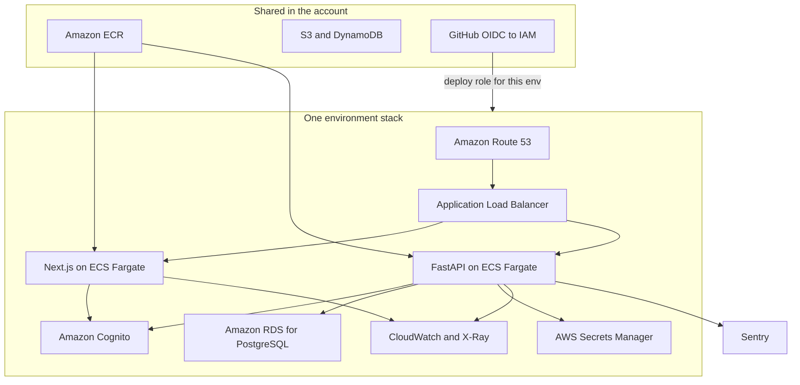
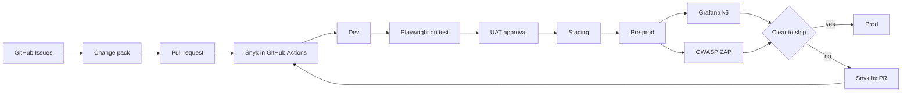

# Architecture

One product lives in this repository. Cursor agents draft the change. GitHub is the only door into AWS. Customers reach the running stacks. A person approves UAT and production.

## Applications

- Intake: GitHub Issues, written into a change pack by a Cursor agent
- Design: Figma for screens, `docs/openapi/api.yaml` for the API
- Implement: Cursor
- QA and testing: Playwright for the UI and the API
- Vulnerability checks: Snyk Code, Snyk Open Source, Snyk Container, and Snyk IaC
- Pen test: OWASP ZAP, baseline on test and an authenticated scan on pre-prod
- Non-functional test: Grafana k6 on pre-prod
- Live AWS configuration: Prowler, weekly
- Secrets in git: GitHub secret scanning
- CI and promotion: GitHub Actions and GitHub Environments
- Infrastructure: Terraform, state in S3, lock in DynamoDB
- Web: Next.js on ECS Fargate
- API: FastAPI on ECS Fargate
- Edge: Route 53 and an Application Load Balancer
- Auth: Amazon Cognito
- Database: Amazon RDS for PostgreSQL
- App secrets: AWS Secrets Manager
- Images: Amazon ECR, one build promoted by digest
- Logs and traces: OpenTelemetry into CloudWatch and X-Ray
- Exceptions: Sentry, when `SENTRY_DSN` is set
- Local run: Docker Compose

Agents use the MCP servers in `.cursor/mcp.json.example`. AWS and Postgres connections stay on dev and test.

## Runtime

Dev, test, UAT, staging, pre-prod, and prod are the same shape. Each stack has its own VPC, load balancer, ECS services, database, Cognito pool, and deploy role. The shared stack holds ECR and the GitHub OIDC provider.

Day one uses one AWS account. Split later into a shared-services account, then separate accounts for staging, pre-prod, and production.

## Delivery

An experiment and a major release both walk this path. The experiment runs the lite Playwright set plus the new feature tests. The major release runs the full Playwright suite, then tags `vX.0.0` after production is healthy.

ECS deployment circuit breaker rolls a bad task set back. The deploy job writes the previous task definition into the job summary before it applies.
